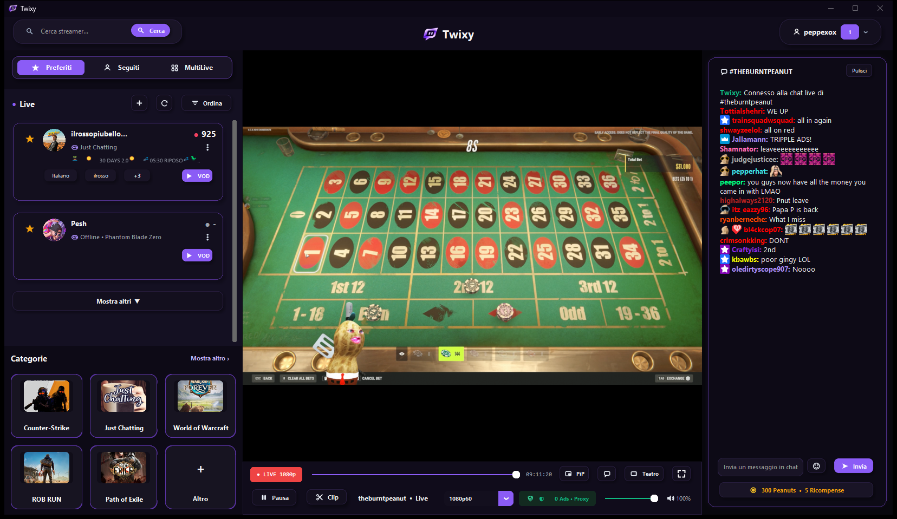
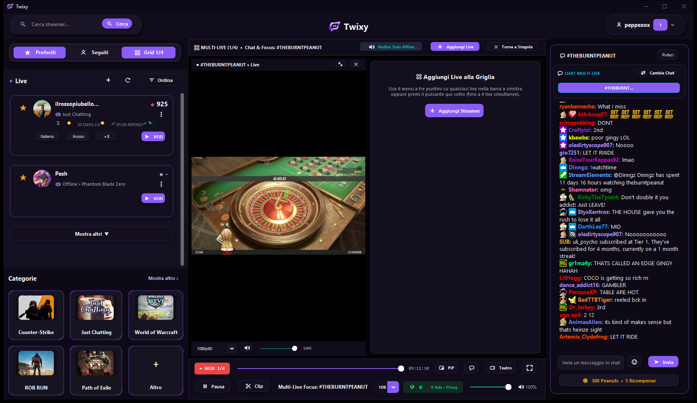
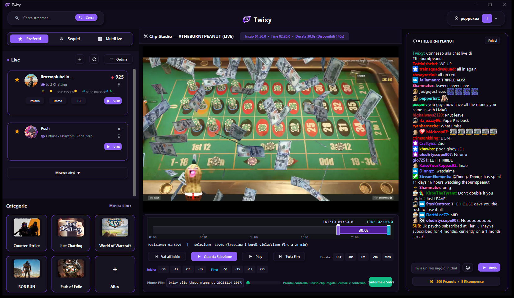
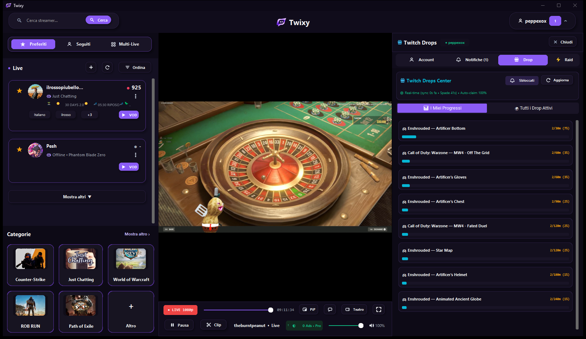

# Twixy

Client desktop nativo per Windows dedicato alla visione di streaming live e VOD, chat in tempo reale con emote 7TV/BTTV/FFZ, Multi-Live a griglia, creazione clip in locale e gestione automatica dei Drops.

> **Target piattaforma:** Windows (`win_x64` / `win_arm64` / `win_x86` tramite rilevamento automatico in fase di build).  
> **Nota:** Twixy è un progetto indipendente open-source e non è affiliato, associato o approvato da Twitch Interactive, Inc.

---

## Funzionalità Principali

- **Motore Video Ibrido (VLC + MPV):** riproduzione fluida basata su `libvlc` (`python-vlc`) e `mpv`, con supporto alla selezione qualità HLS e filtraggio locale dei segmenti pubblicitari (`AdStripperHLSServer`) + fallback su proxy HLS.
- **Multi-Live a Griglia:** guarda fino a **4 stream contemporaneamente** in griglia adattiva con gestione rapida dell'audio per singolo slot.
- **Clip Studio Locale (MP4):** cattura istantanea dei momenti live con finestra di ritaglio (`-1m` / `+1m`) ed esportazione diretta in file `.mp4` sul tuo PC tramite FFmpeg.
- **Chat IRC Completa & Emote Engine (`emote_engine.py`):**
  - Emote e badge **Twitch, 7TV, BTTV e FFZ** caricati e renderizzati in chat.
  - Visualizzazione di **Sondaggi (Polls)**, **Pronostici (Predictions / Bet)** e **Punti Canale**.
- **Centro Drops & Notifiche In-App:** monitoraggio delle campagne Drops attive con riscatto automatico (*Auto-Claim*) e pannello notifiche integrato.
- **VOD & Ricerca Canali:** card dedicate per streamer live e canali seguiti con categoria/gioco, anteprime e sezione VOD.
- **UI Moderna Adattiva:** tema **Chiaro** e **Scuro** con cambio tema istantaneo, modalità **Teatro**, finestra mobile **Picture-in-Picture (PiP)** e HUD Fullscreen.

---

## Anteprima dell'Interfaccia

> *Carica gli screenshot reali in [`docs/screenshots/`](docs/screenshots/README.md) per visualizzarli automaticamente in questa sezione.*

| Interfaccia Principale & Chat | Multi-Live a Griglia |
| :---: | :---: |
|  |  |

| Clip Studio (Salvataggio Locale MP4) | Centro Drops Attivi |
| :---: | :---: |
|  |  |

---

## Download & Installazione (Utenti)

### Opzione 1 — Installer Standalone Windows (Consigliato)
1. Vai nella sezione **[Releases](../../releases)** del repository e scarica `Twixy_Setup_win_x64.exe`.
2. Avvia l'installer: il pacchetto include già **VLC 64-bit** e **MPV**, quindi non richiede installazioni esterne.
3. Scegli la cartella di destinazione (predefinita `%LOCALAPPDATA%\Programs\Twixy`), i collegamenti su Desktop / Menu Start e avvia **Twixy**.

### Opzione 2 — Esecuzione da Sorgente Python
Requisiti:
- **Windows 10 / 11** (64-bit consigliato)
- **Python 3.11 / 3.12+**
- **VLC Media Player 64-bit** installato (o `libvlc.dll` disponibile nel sistema) e **FFmpeg** nel `PATH` (per il salvataggio delle clip in `.mp4`).

Clona il repository, installa le dipendenze e avvia l'app:
```bat
git clone https://github.com/gblandino04-code/Twixy.git
cd Twixy
pip install -r requirements.txt
```
Oppure fai doppio clic su **`avvia.bat`** (o esegui `python xtra_gui.py`).  
Al primo avvio `xtra_gui.py` verifica automaticamente la presenza delle librerie richieste in [`requirements.txt`](requirements.txt).

---

## Compilazione dell'Installer da Sorgente (Build Guide)

Il repository include uno script automatizzato ibrido batch/Python (`crea_installer.bat`) che prepara l'intero pacchetto distribuibile:

1. Assicurati di avere **Python 3** installato e accessibile da terminale (`python` o `py -3`).
2. Esegui **`crea_installer.bat`** (doppio clic o da prompt nella cartella del progetto).
3. Lo script eseguirà in automatico:
   - Controllo e installazione pacchetti build (`pyinstaller`, `customtkinter`, `pillow`, `requests`, `python-vlc`, `py7zr`).
   - Generazione dell'icona `logo.ico` ad alta risoluzione da `logo.png`.
   - Rilevamento/download di **VLC 3.0.21 64-bit** e dell'ultima release **MPV** in `vendor/`.
   - Compilazione dell'eseguibile in `dist/Twixy/Twixy.exe`.
   - Generazione dell'installer finale one-file con indicazione automatica della piattaforma target:
     - `dist/Twixy_Setup_win_x64.exe` (Windows x64)
     - `dist/Twixy_Setup_win_arm64.exe` (Windows ARM64)
     - `dist/Twixy_Setup_win_x86.exe` (Windows 32-bit)

---

## Struttura del Repository

```text
Twixy/
├── xtra_gui.py             # Applicazione principale GUI, player, chat IRC, clip e drops
├── emote_engine.py         # Motore emote e badge (Twitch, 7TV, BTTV, FFZ)
├── avvia.bat               # Launcher rapido Windows senza console
├── crea_installer.bat      # Script build automatico per PyInstaller + Setup Wizard
├── logo.png / logo.ico     # Icone applicazione
├── requirements.txt        # Dipendenze Python runtime
├── LICENSE                 # Licenza MIT + note componenti di terze parti
├── .gitignore              # Esclude config personali (token), log, vendor/ e dist/
└── docs/
    └── screenshots/        # Cartella per gli screenshot reali dell'app
```

---

## Sicurezza & Privacy

- Le impostazioni personali e il token OAuth dell'utente vengono salvati **esclusivamente in locale** nel file `twixy_config.json` (già escluso da Git tramite `.gitignore`).
- **Non condividere mai** il file `twixy_config.json` o i tuoi log (`twixy_crash.log`) in issue pubbliche o commit Git.

---

## Note Legali e Licenze di Terze Parti

- Il codice sorgente di Twixy è rilasciato sotto licenza **[MIT](LICENSE)**.
- Twixy è fornito a scopo **personale ed educativo**. L'utente è responsabile del rispetto dei Termini di Servizio delle piattaforme terze e delle leggi sul diritto d'autore quando utilizza funzioni di riproduzione o salvataggio locale delle clip.
- Se ridistribuisci l'installer compilato contenente binari **VLC (`libvlc`)**, **MPV** o **FFmpeg**, assicurati di includere le relative note di licenza **LGPL / GPLv2+** riportate in [`LICENSE`](LICENSE).
